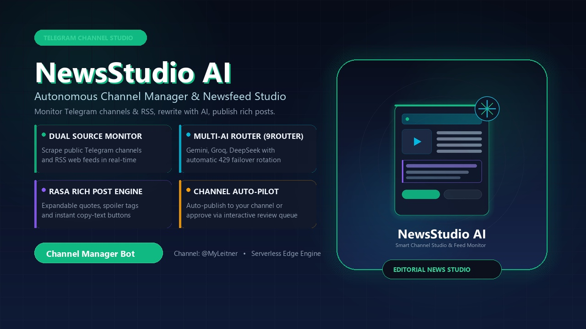
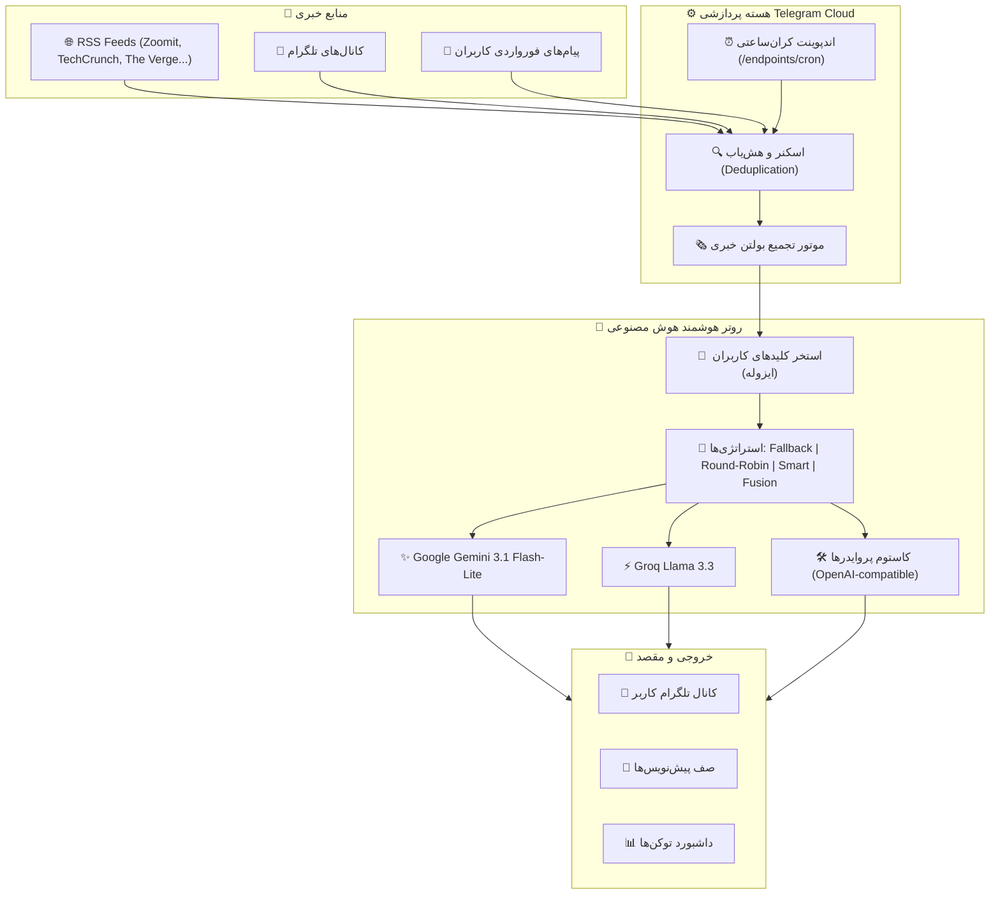

<div align="center">



# 🗞️ NewsStudio 2026 (استودیو خبر)
### Modern Serverless AI Newsroom & Auto-Publishing Engine for Telegram Channels

[](https://cloud.telegram.org)
[](https://ai.google.dev)
[](https://orm.drizzle.team)
[](https://nodejs.org)
[](LICENSE)

<br/>

<p align="center">
  <a href="#-فارسی">🇮🇷 <b>فارسی</b></a> ·
  <a href="#-english">🇬🇧 <b>English</b></a> ·
  <a href="https://mohsen-niksirat.github.io/News-Channel-Bot/">🌐 <b>مشاهده وب‌سایت و راهنما (Live Demo)</b></a>
</p>

</div>

---

<a id="-فارسی"></a>
## 🇮🇷 راهنمای فارسی

**NewsStudio 2026** یک استودیوی تمام‌عیار و ابری (سرورلس) برای مدیریت هوشمند کانال‌های خبری تلگرام است. این ربات با پایش مستمر فیدهای خبری معتبر، بازنویسی حرفه‌ای با به‌روزترین مدل‌های هوش مصنوعی (Google Gemini 3.1 Flash-Lite, Groq, DeepSeek, OpenAI) و روتر هوشمند استخر کلیدها، محتوای ژورنالی جذاب، تمیز و همراه با دکمه‌های شیشه‌ای تولید و به کانال شما ارسال می‌کند.

> 🌐 **وب‌سایت و آموزش گرافیکی آنلاین:** [https://mohsen-niksirat.github.io/News-Channel-Bot/](https://mohsen-niksirat.github.io/News-Channel-Bot/)

### 🌟 قابلیت‌های کلیدی

1. **⚡ معماری ۱۰۰٪ بدون سرور (Telegram Cloud Serverless):**
   - بدون نیاز به سرور مجازی (VPS) یا هزینه‌های نگهداری ماهانه.
   - اجرای ابری خودکار روی زیرساخت رسمی `tgcloud` با مقیاس‌پذیری آنی و پایداری ۲۴/۷.
2. **🧠 روتر چندپرووایدر هوش مصنوعی (مشابه 9Router):**
   - پشتیبانی از استخر نامحدود کلیدهای Gemini، Groq، DeepSeek، OpenAI، OpenRouter و **ارائه‌دهنده‌های سفارشی (Custom Providers)**.
   - ۴ استراتژی هوشمند مسیریابی: **فالبک اولویتی (Fallback)**، **راند رابین چرخشی (Round-Robin)**، **روتر هوشمند سلامت‌محور (Smart Router)** و **فیوژن (Fusion)**.
3. **🔐 ایزولاسیون کامل حریم خصوصی و اولویت کلیدها:**
   - هر کاربر فقط کلیدها و پروایدرهای اختصاصی خود را مدیریت و مصرف می‌کند.
   - قابلیت جابجایی ترتیب کلیدها با دکمه‌های ⬆️ و ⬇️ برای تغییر اولویت مصرف.
4. **🧪 تست زنده سلامت کلیدها و کشف مدل‌های فعال و رایگان:**
   - سنجش تاخیر پاسخگویی (Latency) و تست اتصال کلیدها تنها با یک کلیک (`/testkeys`).
   - استخراج خودکار و نمایش مدل‌های فعال و رایگان (مانند `gemini-3.1-flash-lite`، `gemma-4-26b-a4b-it`، `llama-3.3-70b-versatile`).
   - ارائه تمام نتایج به صورت یک پست جامع و کپی‌کردن نام مدل‌ها با یک ضربه.
5. **🗞️ بولتن تجمیعی هوشمند ضد اسپم (Anti-Spam Hourly Bulletin):**
   - پایش هوشمند دوره‌ای: اگر در یک بازه ۱ یا ۲ خبر جدید باشد، به صورت پست‌های مستقل و تحلیلی منتشر می‌شوند.
   - در صورت وجود **۳ خبر یا بیشتر**، همه در قالب یک **بولتن خبری ساعتی واحد** همراه با تیترهای جذاب، خلاصه روان و لینک اختصاصی هر منبع تجمیع می‌شوند تا کانال شلوغ نشود.
6. **📊 داشبورد تحلیل توکن‌ها و هزینه‌ها (`/tokens`):**
   - گزارش دقیق مصرف توکن به تفکیک امروز، ۷ روز اخیر، ماهانه، کل دوره و بر حسب پروایدرها.
7. **📨 خلاصه‌ساز پیام‌های پی‌وی و فورواردی:**
   - امکان فوروارد کردن هر پیام، متن یا خبر طولانی از چت‌ها یا کانال‌ها به ربات جهت تبدیل فوری به پست کانال.
8. **📑 صف بررسی پیش‌نویس‌ها و انتشار مستقیم:**
   - قابلیت فعال‌سازی انتشار خودکار (Auto-Publish) یا بررسی دستی با دکمه‌های ✅ انتشار، 🔁 بازنویسی و ❌ رد.

---

### 🏛️ معماری سیستم



---

### 🚀 راهنمای نصب و راه‌اندازی سریع

#### ۱. پیش‌نیازها
* [Node.js 20+](https://nodejs.org)
* یک ربات در تلگرام از طریق [@BotFather](https://t.me/BotFather)

#### ۲. دریافت و ساخت پروژه در تلگرام کلود
```bash
# ایجاد پروژه ابری رسمی
npm create @tgcloud/bot NewsStudio_Bot
cd NewsStudio_Bot

# دریافت وابستگی‌ها
npm install
```

#### ۳. تنظیم دیتابیس و مهاجرت اسکیما
```bash
npx tgcloud migrate --safe
```

#### ۴. استقرار روی تلگرام کلود (Deploy)
```bash
npx tgcloud push
```
پروژه شما بلافاصله روی سرورهای تلگرام قرار گرفته و آماده پاسخگویی می‌شود!

#### ۵. تنظیم کران‌جاب ساعتی رایگان
برای اینکه ربات هر یک ساعت به‌صورت خودکار منابع را پایش کرده و بولتن منتشر کند:
1. وارد سایت رایگان [cron-job.org](https://cron-job.org) شوید.
2. یک جاب جدید با دوره زمانی **هر ۱ ساعت** ایجاد کنید.
3. آدرس URL را برابر با اندپوینت زیر قرار دهید (جایگزین کردن `app_id` پروژه خودتان):
   ```text
   https://cloud.telegram.org/<YOUR_APP_ID>/endpoints/cron
   ```

---

<a id="-english"></a>
## 🇬🇧 English Documentation

**NewsStudio 2026** is a state-of-the-art serverless newsroom and automated content studio for Telegram channels. Powered by modern AI engines (**Google Gemini 3.1 Flash-Lite**, **Groq**, **DeepSeek**, and OpenAI-compatible custom endpoints), it continuously monitors RSS feeds and Telegram channels, extracts breaking updates, rewrites them into journalistic Persian posts, and delivers them directly to your channel with rich buttons.

### ✨ Key Features

- **⚡ 100% Serverless on Telegram Cloud:** No servers, no VPS, zero hosting costs, infinite scalability.
- **🧠 9Router Multi-Provider Architecture:** Manage unlimited keys across Gemini, Groq, DeepSeek, and custom base URLs.
- **🔀 4 Intelligent Routing Policies:**
  - *Priority Fallback:* Uses top-priority keys first and fails over automatically.
  - *Round-Robin:* Distributes workload evenly to maximize rate-limits.
  - *Smart Router:* Health-aware key selection minimizing latency and 429 errors.
  - *Advanced Fusion:* High-fidelity journalistic style.
- **🔐 Multi-Tenant Key Privacy:** Strict tenant isolation with priority up/down reordering (`⬆️`/`⬇️`).
- **🧪 Key Health & Model Inspector (`/testkeys`):** Live ping latency test + automated discovery of free & high-throughput models.
- **🗞️ Anti-Spam Hourly Bulletin Aggregator:** Automatically bundles 3+ news items into a single editorial digest with clickable hyperlinks `<a href="...">` to preserve channel readability.
- **📊 Real-time Token Analytics (`/tokens`):** Track token consumption by day, week, month, key, and provider.
- **📨 On-Demand Forward Summarizer:** Forward any long article, tweet, or message to turn it into an engaging Telegram post.

---

### 📋 Bot Commands (`BOTCOMMANDS.txt`)

| Command | Description |
| :--- | :--- |
| `/start` | 🚀 Initialize bot and launch main menu |
| `/scan` | 🔍 Trigger an immediate news scan and AI analysis |
| `/review` | 📑 Open the draft review queue |
| `/newspaper` | 🗞️ Generate a custom newspaper edition |
| `/sources` | 📡 Manage RSS feeds and Telegram sources |
| `/ai` | 🤖 AI key pool, routing policies & custom providers |
| `/testkeys` | 🧪 Live key health check & active model discovery |
| `/tokens` | 📊 Token usage and cost analytics dashboard |
| `/channel` | 📢 Channel setup and auto-publishing toggle |
| `/cancel` | ❌ Cancel current state and return to main menu |

---

### 📄 License

This project is open-source under the [MIT License](LICENSE).
Created with ❤️ by **[Mohsen Niksirat](https://github.com/mohsen-niksirat)**.
